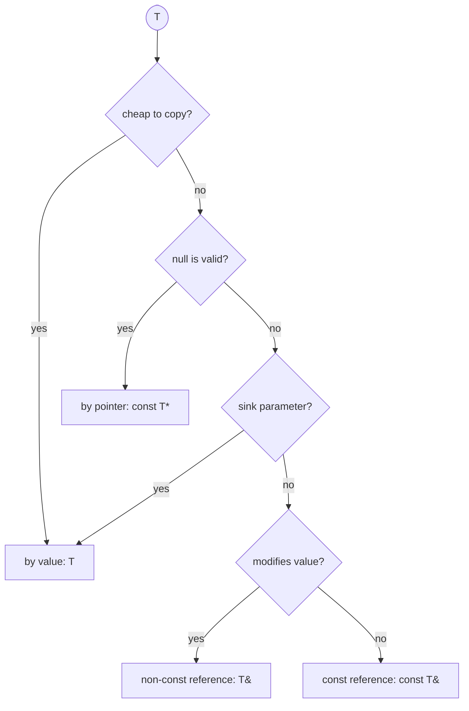

[← Guides](README.md)

# Parameter Passing

> Pass by value for cheap-to-copy types, by const reference for expensive read-only parameters, and by pointer only when null is a meaningful state.

---

## By Value

Use for built-in types, iterators, small structs, and any parameter the function will store or consume.

```cpp
void scale(float factor, std::vector<float>& data);   // float is cheap — pass by value
```

For *sink parameters* — where the function will store or move from the argument — by-value is the correct default. The caller can move to avoid the copy:

```cpp
void Cache::insert(std::string key) {
    store_[std::move(key)] = compute();
}

cache.insert(std::move(large_key));   // no copy
cache.insert("literal");              // one construction — same cost as const ref
```

Taking a sink by `const T&` forces a copy inside; by value lets the caller choose.

---

## By Const Reference

Use for non-trivial types the function only reads and does not store.

```cpp
void print(const std::string& s);
bool equal(const Matrix& a, const Matrix& b);
void process(const std::vector<int>& data);
```

This is the default for anything expensive to copy that the function will not keep.

---

## By Pointer

Use when null is a valid and meaningful input.

```cpp
void render(const Texture* overlay);   // null means "no overlay"
```

A non-null pointer parameter is a code smell — prefer `const T&` instead. Pointer parameters make call sites noisy (`&x` everywhere) and invite null-checks that shouldn't be needed.

---

## By Non-Const Reference

Use for in-out parameters the function both reads and modifies.

```cpp
void normalize(std::vector<float>& data);
```

Prefer returning the result when practical — `f(x)` looks like a read-only call, so a non-const reference parameter is easy to miss at the call site.

---

## Prefer



Never use a raw pointer to avoid a copy — that is `const T&`'s job.
