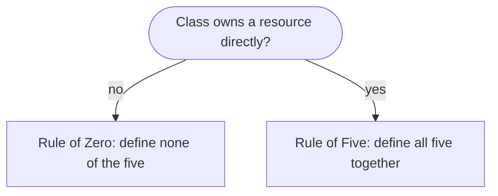

[← C++ Field Guide](../README.md)

# Rule of Five

> If a class manages a resource directly, define all five special member functions together — destructor, copy constructor, copy assignment, move constructor, and move assignment — or none of them, per the rule of zero.

---

## Rule of Three

Before C++11, a class that needed a custom destructor almost always needed a custom copy constructor and copy assignment operator too. The three are coupled: a custom destructor signals the class owns a resource that the compiler-generated (memberwise) copy would handle incorrectly.

```cpp
class Buffer {
public:
    explicit Buffer(std::size_t size) : data_(new int[size]), size_(size) {}
    ~Buffer() { delete[] data_; }

private:
    int* data_;
    std::size_t size_;
};

Buffer a(10);
Buffer b = a;   // implicit shallow copy: b.data_ == a.data_
                // both destructors delete[] the same pointer — double free
```

Defining only the destructor leaves the implicit copy constructor and copy assignment operator in place, and both copy `data_` as a raw pointer value rather than the buffer it points to. See [Copy-and-Swap](../idioms/copy-and-swap.md) for a pattern that implements the copy assignment operator correctly. Reference: [rule of three/five/zero](https://en.cppreference.com/w/cpp/language/rule_of_three).

---

## Rule of Five

_C++11_

Move semantics add two more special member functions: the move constructor and move assignment operator. Declaring a destructor, copy constructor, or copy assignment operator suppresses the implicitly-generated move members — they are not just wrong, they don't exist. A class written to the rule of three still compiles under C++11, but every `std::move` on it silently falls back to the copy constructor instead of failing to compile.

```cpp
class Buffer {
public:
    explicit Buffer(std::size_t size) : data_(new int[size]), size_(size) {}

    ~Buffer() { delete[] data_; }

    Buffer(const Buffer& other)
        : data_(new int[other.size_]), size_(other.size_) {
        std::copy(other.data_, other.data_ + size_, data_);
    }

    Buffer& operator=(const Buffer& other) {
        if (this != &other) {
            delete[] data_;
            data_ = new int[other.size_];
            size_ = other.size_;
            std::copy(other.data_, other.data_ + size_, data_);
        }
        return *this;
    }

    Buffer(Buffer&& other) noexcept
        : data_(std::exchange(other.data_, nullptr)), size_(std::exchange(other.size_, 0)) {}

    Buffer& operator=(Buffer&& other) noexcept {
        if (this != &other) {
            delete[] data_;
            data_ = std::exchange(other.data_, nullptr);
            size_ = std::exchange(other.size_, 0);
        }
        return *this;
    }

private:
    int* data_;
    std::size_t size_;
};
```

Omitting the move pair is not a compile error, which is what makes it easy to miss: the class still works, it just quietly allocates and copies on every move instead of stealing the source's pointer. Defining one move member without the other is also possible but leaves the class inconsistent — write both together.

---

## Rule of Zero

The rule of five is a lot of boilerplate to get right. Avoid needing it at all by never owning a resource directly — compose the class from members that already manage their own lifetime.

```cpp
class Buffer {
public:
    explicit Buffer(std::size_t size) : data_(size) {}

private:
    std::vector<int> data_;   // owns the resource; all five special members are correct as generated
};
```

`std::vector` already implements its own rule of five. With no raw resource left to manage, the compiler-generated destructor, copy, and move members are all correct, and none need to be written.

---

## Prefer



Default to the rule of zero: build classes out of RAII members like `std::vector`, `std::string`, and `std::unique_ptr` so the compiler generates all five special member functions correctly. Reach for the rule of five only when a class must own a resource directly, and define all five together — needing one is strong evidence you need the rest.
